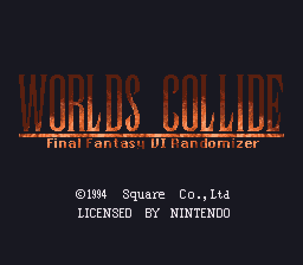
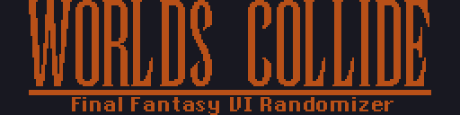
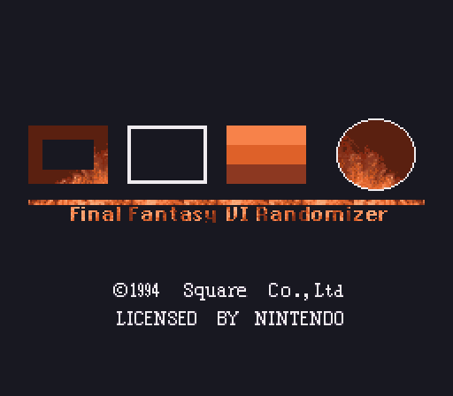

# Editing the title screen

This guide shows how to change the logo on the title screen with `graphics/tools/title_screen.py`. You need Python, [Pillow](https://pypi.org/project/pillow/) (`pip install pillow`) and any image editor that can save a PNG.



The logo is everything in the band across the middle of the screen: the big letters, the line under them and the subtitle. The tool lets you replace that band with your own picture. The two copyright lines, the fire and the timing of the screen are not part of the logo; the last section says what is known about the rest of the data.

## Quick start

Run these from the repository root.

1. Export the current logo to a PNG:

   ```sh
   python3 graphics/tools/title_screen.py export my-logo.png
   ```

2. Edit `my-logo.png` in an image editor. Keep it 256x64 pixels and use the colors described below.

3. Make title data from your picture:

   ```sh
   python3 graphics/tools/title_screen.py import my-logo.png "graphics/title/My Title.bin"
   ```

   The tool prints how much of the space your logo uses, or says what is wrong with it.

4. Tell the randomizer to use your file: in `data/title_graphics.py`, change the file name in the `open(...)` line to `graphics/title/My Title.bin`.

5. Roll a seed (`python3 wc.py -i ff3.smc`) and open it in an emulator to see your title screen.

## The logo picture

The exported PNG looks like this (shown at twice its size):



It is 256 pixels wide, the full width of the screen, and 64 pixels tall. On the screen its top edge is 64 pixels down.

The picture is a stencil. Where it has the fire color, the fire behind the logo shows through, and that is how the letters get their burning texture. Everywhere else it covers the fire with a flat color.

| Color | RGB in the PNG | On the title screen |
|-------|----------------|---------------------|
| 0 | 184, 80, 24 | See-through: the fire shows here |
| 1 | 24, 24, 33 | The dark background around the logo |
| 2 | 239, 235, 239 | White |
| 5 | 247, 130, 74 | Light orange |
| 6 | 222, 97, 41 | Orange |
| 7 | 140, 56, 33 | Dark orange |
| 3, 4, 8-15 | 0, 0, 0 | Black |

The fire is a picture of flames rising from the bottom of the band, so see-through areas are brightest near the bottom and darker brown toward the top. The Worlds Collide logos only use colors 0 and 1; the others are there if you want solid white or orange details.

`guide/colors-logo.png` is a logo that uses every color. Imported, it looks like this:



When you save your picture, the tool matches each pixel to the nearest color in the table, so it does not matter whether your editor keeps the PNG's palette or saves full color. If some pixels are not exactly one of the colors (anti-aliased edges, for example) the tool tells you how many it had to round. Turn anti-aliasing off for clean edges.

## Limits

The logo has to fit in two fixed spaces, and the tool checks both.

- **136 tiles.** The game stores the logo as 8x8 pixel tiles, and each *different* tile is stored once. An all-background tile is always one of them. A logo that covers the whole band with detail needs 256 tiles and will not fit, but most logos have a lot of empty space and repeated shapes.
- **24,214 bytes compressed.** The whole title screen is compressed into this space. The logo is a small part of it, so this only fails for very noisy pictures.

If you run out of tiles:

- Line repeated shapes up on the 8 pixel grid. Two copies of a letter share their tiles only if both start the same distance from a tile edge. In the Worlds Collide logo the letters are 16 pixels apart for this reason.
- Use straight stems and flat areas. A tall letter whose middle is the same in every row uses one tile there, however tall it is.
- Leave empty space empty: every empty tile is the same tile.

`python3 graphics/tools/title_screen.py info "graphics/title/My Title.bin"` shows how many tiles and bytes a title uses.

## Starting from another title

`--source` picks the title to start from. It can be any file in `graphics/title` or a ROM, for example the original game:

```sh
python3 graphics/tools/title_screen.py export original-logo.png --source ff3.smc
```

`import` takes everything except the logo from the source, so the rest of the screen stays as it is there.

## How it works

This part is for whoever needs to go further than the logo.

**Where the data is.** The title screen is one compressed block in the ROM at `18f000`-`194e95` (24,214 bytes). The files in `graphics/title` are that block, and `data/title_graphics.py` writes one of them over the original. The block starts with its own length as a 2 byte number; anything after that length is padding.

**Compression.** It is the game's usual LZ format. After the length come groups of a control byte and up to 8 values. A 1 bit in the control byte (lowest bit first) means the next byte is copied as is. A 0 bit means the next 2 bytes say "repeat earlier output": the low 11 bits are a position in a 2048 byte ring buffer of recent output and the high 5 bits are the number of bytes minus 3. The buffer starts filled with zeros and writing starts at position `7de`. `utils/compression.py` has `compress` and `decompress`.

One trap: the game only checks for the end of the data after reading a value. Compressed data must therefore never end with a control byte that has nothing after it, or the game keeps reading past the end and the screen stays black. `compress` used to do this when the number of values was a multiple of 8; it no longer does.

**What is inside.** Decompressed, the block is 44,712 bytes. The parts the tool uses:

| Offset | Size | Contents |
|--------|------|----------|
| `8be0` | 512 | Logo tilemap: 32x8 tile numbers, 2 bytes each, low byte first |
| `8de0` | 4352 | Logo tiles: 136 tiles of 32 bytes, 4 bits per pixel. Tile 0 also fills the rest of the layer |
| `9ee0` | | Characters for the copyright lines, 2 bits per pixel. The © is the first of them |

At the title screen the game copies the logo tilemap into the background tilemap at VRAM `0800` (rows 8-15), adding `0777` to each entry: tile number plus `377`, palette 1. The tiles are at VRAM `cee0`, which is tile `377` of a tile set starting at `6000`.

Other blocks of the data can be seen in VRAM at the title screen. What they are for has not been worked out:

| Offset | Size | VRAM address |
|--------|------|--------------|
| `23c0` | 1984 | `0000` (a tilemap) |
| `2bc0` | 2048 | `1000` |
| `33c0` | 16928 | `8000` (graphics) |
| `7b30` | 1712 | `4000` |
| `83e0` | 2048 | `5000` |

**Editing the rest.** `unpack` writes the decompressed data to a file and `pack` compresses an edited copy back into title data:

```sh
python3 graphics/tools/title_screen.py unpack title.dat
python3 graphics/tools/title_screen.py pack title.dat "graphics/title/My Title.bin"
```

The data must stay 44,712 bytes. `graphics/title_screen.py` has the code the tool is built on, and `tests/test_title_screen.py` checks it against the title data in this directory.
