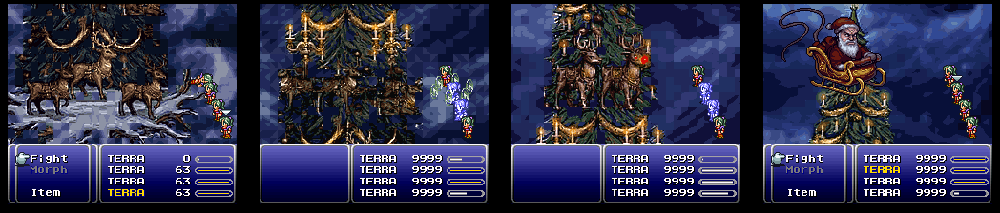

# Christmas final battle

A one-off patch for a ROM that Worlds Collide has already made. The three tiers of the Statue of
the Gods become three stories of a christmas tree with reindeer, and final Kefka becomes Santa in
his sleigh on top of it.



Only looks change. Every enemy keeps its stats and its script; the enemies of the tiers are moved
onto the reindeer, and final Kefka is named Santa.

## Use

```sh
python3 tools/christmas_final_battle/christmas_final_battle.py IN.smc OUT.smc
```

It needs only python, and `christmas_data.json` beside it.

The ROM has to be one Worlds Collide made (4 MB) with the default final boss. If anything is not
as the tool expects (another final boss, a ROM that is already patched, no empty bank), it says
why and writes nothing.

## What it changes

- **Tiers 1 to 3** are battle backgrounds 0x33 to 0x35, and tier 4's is 0x36. Each gets 2 sets of
  128 tiles, a tilemap and 2 palettes of 15 colors: what the scroll from one tier to the next has
  room for.
- **The enemies of the tiers** all have the same sprite, a beast that was part of the statue. They
  get one that is not seen, and their positions are points on the reindeer: the hand that points
  at an enemy is where its sprite is. A position is in steps of 8 pixels and 15 of them at the
  most, so for a reindeer further right its one tile is some tiles into its mold.
- **Santa** is final Kefka's sprite: his tiles, mold and palette are written over Kefka's own, and
  his name.
- The new tiles and tilemaps go to an empty bank of the ROM (F1 and F3 to FF are empty in a
  rolled ROM). The game takes tilemaps from bank E7 only, so its loader (C1/1C85) is sent to a
  small routine there that reads a pointer table of its own.

## Rebuilding the data

`christmas_data.json` is made from the two pictures in `pictures/`:

```sh
python3 tools/christmas_final_battle/build_data.py \
    tools/christmas_final_battle/pictures/tree.webp \
    tools/christmas_final_battle/pictures/santa.webp \
    VANILLA.smc tools/christmas_final_battle/christmas_data.json [PREVIEW_DIR]
```

Run it from the repository (it uses `utils/compression.py`); it needs PIL and numpy.

- The tree is sharpened, cut into four slices at half its size, and each slice is brought within
  the limits above. The sky is blurred first and its tiles are the first to be merged, so the
  tree and the reindeer keep their detail and the sky takes the loss.
- Santa's picture is pixel art shown large. Its own pixels are found and used as they are.
- The compressed blocks never end with a flag byte that has nothing after it. The game's loader
  does not stop at such an end, and the battle would not start.
